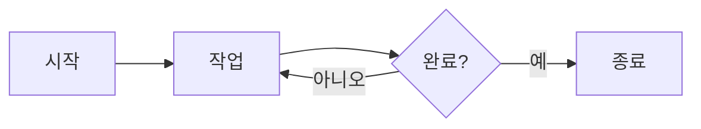

Markdown(마크다운) 문법 정리
Markdown은 일반 텍스트에 간단한 기호를 추가하여 서식을 지정하는 경량 마크업 언어이다.
1. 기본적인 줄바꿈과 문단

Markdown은 일반적인 메모장과 줄바꿈 처리 방식이 다르다.

1-1. 문단 줄바꿈

문단과 문단 사이에 빈 줄을 하나 넣는다.

markdown
첫 번째 문단

두 번째 문단

1-2. 같은 문단 내 줄바꿈

일반적인 엔터 한 번은 줄바꿈으로 인식되지 않을 수 있다.

줄바꿈을 표현하는 방법은 다음과 같다.

방법 1. 문장 끝에 공백 두 칸

markdown
첫 번째 줄  
두 번째 줄


방법 2. 역슬래시() 사용

markdown
첫 번째 줄\
두 번째 줄


방법 3. HTML <br> 태그 사용

markdown
첫 번째 줄<br>
두 번째 줄


※ 렌더러에 따라 지원 방식이 다를 수 있다.

2. 제목(Heading)

# 기호를 사용하여 제목의 크기와 계층을 구분한다.

markdown
# 제목 1
## 제목 2
### 제목 3
#### 제목 4
##### 제목 5
###### 제목 6

# 1개: 가장 큰 제목
## 2개: 두 번째 단계
### 3개: 세 번째 단계
최대 6단계까지 사용 가능
일반적으로 # 뒤에 공백을 넣어야 한다.
주의할 점: #과 태그
markdown
# 제목
#태그


두 문법은 다르다.

# 제목: Markdown 제목
#태그: 제목 문법이 아님. Obsidian 등에서는 태그로 활용 가능

일부 서비스에서는 해시태그를 별도 기능으로 처리한다.

제목과 부제목을 구분하는 방법
markdown
제목 1
======

제목 2
------


위 문법은 각각 H1, H2에 해당한다.

3. 구분선(Horizontal Rule)

세 개 이상의 하이픈(-), 별표(*), 밑줄(_)을 사용한다.

markdown
---
***
___


문서의 내용이나 주제를 구분할 때 사용한다.

4. 리스트(List)
4-1. 순서 없는 리스트(Unordered List)

다음 세 가지 기호를 사용할 수 있다.

markdown
- 사과
- 바나나
- 포도

markdown
* 사과
* 바나나
* 포도

markdown
+ 사과
+ 바나나
+ 포도


세 가지 모두 순서 없는 리스트이다.

4-2. 중첩 리스트(Nested List)

들여쓰기를 이용해 하위 항목을 만든다.

markdown
- 내가 좋아하는 것
  - 수박
  - 캔디
  - neon
    - 추가 항목

상위 항목
하위 항목
하위의 하위 항목

※ 일반적으로 공백 2~4칸을 사용한다. 사용하는 Markdown 엔진에 따라 요구하는 들여쓰기가 다를 수 있다.

4-3. 순서 있는 리스트(Ordered List)

숫자와 마침표를 사용한다.

markdown
1. 리센느 - with
2. 리센느 - 백화요란
3. A20 Lite - Neon
4. A20 Soul - ?????
5. A20 May - ?????


숫자를 반드시 순차적으로 작성할 필요는 없다.

markdown
1. 첫 번째
1. 두 번째
1. 세 번째


대부분의 Markdown 렌더러는 자동으로 번호를 정렬한다.

4-4. 혼합 리스트

순서 있는 리스트와 순서 없는 리스트를 함께 사용할 수 있다.

markdown
1. 과일
   - 수박
   - 사과
2. 음료
   - 콜라
   - 주스

4-5. 체크박스(Task List)

GitHub Flavored Markdown(GFM) 등에서 지원한다.

markdown
- [ ] 해야 할 일
- [x] 완료한 일
- [ ] 아직 안 한 일

[ ]: 미완료
[x]: 완료

※ Obsidian에서는 체크박스를 할 일 관리에 활용할 수 있다.

5. 텍스트 꾸미기(Emphasis)
5-1. 기울임(Italic)

별표 또는 밑줄 하나를 사용한다.

markdown
*기울이기*
_기울이기_

5-2. 굵게(Bold)

별표 또는 밑줄 두 개를 사용한다.

markdown
**진하게**
__진하게__

5-3. 굵게 + 기울임(Bold + Italic)

별표 또는 밑줄 세 개를 사용한다.

markdown
***굵고 기울이기***
___굵고 기울이기___

5-4. 취소선(Strikethrough)

물결표 두 개를 사용한다.

markdown
~~취소선~~

5-5. 형광펜(Highlight)

기본 Markdown 문법은 아니다.

Obsidian에서는 다음 문법을 지원한다.

markdown
==형광펜 표시==


HTML을 지원하는 환경에서는 다음과 같이 사용할 수 있다.

HTML
<mark>형광펜 표시</mark>

5-6. 아래첨자와 위첨자

HTML 태그를 이용할 수 있다.

HTML
H<sub>2</sub>O
X<sup>2</sup>

6. 코드(Code)
6-1. 인라인 코드(Inline Code)

백틱(`) 하나로 감싼다.

markdown
`print("Hello World")`


문장 중간에 코드나 명령어를 표시할 때 사용한다.

6-2. 코드 블록(Code Block)

백틱 세 개를 사용한다.

markdown
```
12345678
```

6-3. 코드 블록 + 언어 지정

첫 번째 백틱 세 개 뒤에 언어 이름을 입력한다.

markdown
```python
print("Hello World")
```


주요 언어 지정 예시

언어	지정 이름
Python	python
JavaScript	javascript
HTML	html
CSS	css
Java	java
C	c
C++	cpp
JSON	json
SQL	sql
Bash	bash
Markdown	markdown

※ 코드 하이라이팅 지원 여부는 렌더러에 따라 다르다.

7. 인용문(Blockquote)

> 기호를 사용한다.

7-1. 기본 인용
markdown
> 이것은 인용문입니다.

7-2. 중첩 인용
markdown
> 첫 번째 인용
> > 두 번째 인용
> > > 세 번째 인용

7-3. 여러 줄 인용
markdown
> 여러분들 스트레칭하세요.
>
> - 지나가던 프로그래밍 아저씨


인용문 안에서도 제목, 리스트, 코드 등을 사용할 수 있다.

8. 링크(Link)
8-1. 기본 링크
markdown
[표시할 문자](https://naver.com)


결과: 네이버

8-2. 링크에 제목(툴팁) 추가
markdown
[네이버](https://naver.com "네이버 홈페이지")

8-3. URL 직접 표시
markdown
<https://naver.com>

8-4. 링크 자체를 코드로 표시
markdown
`[네이버](https://naver.com)`


※ 백틱으로 감싸면 링크가 실제로 작동하지 않고 코드로 표시된다.

9. 이미지(Image)
9-1. 기본 이미지
markdown


!: 이미지임을 표시
[]: 대체 텍스트(Alt Text)
(): 이미지 경로 또는 URL
9-2. 인터넷 이미지 불러오기
markdown


9-3. 이미지에 링크 연결하기

이미지 문법 전체를 링크 문법으로 감싼다.

markdown
[](https://naver.com)


이미지를 클릭하면 지정한 링크로 이동한다.

9-4. 이미지 크기 조절

기본 Markdown에는 이미지 크기 조절 문법이 없다.

HTML을 지원하는 환경에서는 다음처럼 사용할 수 있다.

HTML


10. 표(Table)

파이프(|)와 하이픈(-)을 사용한다.

10-1. 기본 표
markdown
| 제목 1 | 제목 2 | 제목 3 |
|---|---|---|
| 내용 1 | 내용 2 | 내용 3 |
| 내용 4 | 내용 5 | 내용 6 |

10-2. 정렬 방식

표의 두 번째 줄에 콜론(:)을 추가한다.

문법	정렬 방식
:---	왼쪽 정렬
---:	오른쪽 정렬
:---:	가운데 정렬
---	기본 정렬(일반적으로 왼쪽)
10-3. 정렬 적용 예시
markdown
| 왼쪽 | 가운데 | 오른쪽 |
|:---|:---:|---:|
| 사과 | 바나나 | 포도 |
| 100 | 200 | 300 |

10-4. 간단한 표
markdown
| 제목 |
|---|
| 내용 |


※ 표는 기본 Markdown의 일부가 아니라 GFM 등 확장 문법으로 제공되는 경우가 많다.

11. HTML 사용하기

Markdown은 HTML 태그를 함께 사용할 수 있는 경우가 많다.

11-1. 가운데 정렬
HTML
<center>가운데 정렬</center>


다른 방법:

HTML
<p align="center">가운데 정렬</p>

11-2. 글자 색상
HTML
<span style="color:red">빨간 글씨</span>

11-3. 줄바꿈
HTML
첫 번째 줄<br>
두 번째 줄

11-4. 접기 / 펼치기
HTML
<details>
<summary>내용 펼치기</summary>

숨겨진 내용입니다.

</details>


※ HTML 지원 범위와 보안 정책은 플랫폼마다 다르다.

12. 특수문자와 이스케이프(Escape)

Markdown에서 특정 기능을 수행하는 기호를 문자 그대로 출력하고 싶을 때 사용한다.

역슬래시(\)를 기호 앞에 붙인다.

markdown
\# 제목이 아닌 문자
\* 별표
\- 하이픈
\> 인용이 아닌 문자
\` 백틱

자주 사용하는 특수문자
문자	용도
\	이스케이프
#	제목
*	리스트, 강조
_	강조
-	리스트, 구분선
>	인용
`	코드
[]	링크, 체크박스
()	링크 주소
|	표 구분
~	취소선
HTML 주석
HTML
<!-- 화면에 표시되지 않는 주석 -->


주석은 일반적으로 렌더링 결과에 표시되지 않는다.

13. Mermaid(다이어그램)

Markdown 확장 기능으로 텍스트를 이용해 다이어그램을 작성할 수 있다.

단, Mermaid를 지원하는 렌더러가 필요하다.

13-1. 흐름도(Flowchart)
markdown


13-2. 방향 지정
코드	방향
TB	위에서 아래
TD	위에서 아래
BT	아래에서 위
LR	왼쪽에서 오른쪽
RL	오른쪽에서 왼쪽
13-3. 노드 모양
mermaid
flowchart LR
    A[사각형]
    B(둥근 사각형)
    C{다이아몬드}
    D((원형))

13-4. 연결선
mermaid
flowchart LR
    A --> B
    B --- C
    C -.-> D
    D ==> E

-->: 화살표
---: 일반 연결선
-.->: 점선 화살표
==>: 굵은 화살표
14. Markdown 확장 기능

일반 Markdown과 플랫폼별 확장 문법을 구분해서 알아두면 좋다.

기능	일반 Markdown	확장 또는 플랫폼
제목	O	
문단	O	
리스트	O	
인용	O	
코드 블록	O	
링크	O	
이미지	O	
표		GFM 등
체크박스		GFM 등
취소선		GFM 등
형광펜		Obsidian 등
Mermaid		지원 플랫폼
접기/펼치기		HTML, 플랫폼별 지원
각주		GFM, Obsidian 등
태그		Obsidian 등
14-1. 각주(Footnote)

지원하는 환경에서 다음처럼 사용한다.

markdown
이것은 각주가 있는 문장입니다.[^1]

[^1]: 이것은 각주 설명입니다.

14-2. Obsidian 내부 링크

Obsidian에서 사용하는 위키 링크 문법이다.

markdown
[[문서 이름]]
[[문서 이름#제목]]
[[문서 이름|표시할 이름]]

14-3. Obsidian 태그
markdown
#공부
#Markdown
#프로그래밍


태그를 이용해 노트를 분류하고 검색할 수 있다.

15. 최종 복습 체크리스트
문단 줄바꿈과 문장 내 줄바꿈 차이
제목 1~6단계
구분선
순서 없는 리스트
순서 있는 리스트
중첩 리스트와 들여쓰기
체크박스
기울임과 굵게
취소선과 형광펜
인라인 코드와 코드 블록
인용문과 중첩 인용
링크와 이미지
이미지에 링크 연결하기
표와 정렬
HTML 태그
이스케이프와 주석
Mermaid 다이어그램
Obsidian 전용 문법
핵심 기억 사항
빈 줄 하나 = 문단 구분
공백 두 칸 또는 역슬래시 = 문단 내 줄바꿈
# 뒤에는 공백을 넣어 제목 작성
-, *, + = 순서 없는 리스트
1. = 순서 있는 리스트
- [ ] = 체크박스
**내용** = 굵게
*내용* = 기울임
~~내용~~ = 취소선
백틱 하나 = 인라인 코드
백틱 세 개 = 코드 블록
> = 인용문
[텍스트](주소) = 링크
 = 이미지
| = 표의 열 구분
\ = 특수문자 이스케이프

가장 중요한 점: Markdown은 하나의 고정된 규격만 있는 것이 아니다. CommonMark, GFM(GitHub Flavored Markdown), Obsidian 등 사용하는 환경에 따라 지원하는 기능과 표현 방식이 달라질 수 있다.
